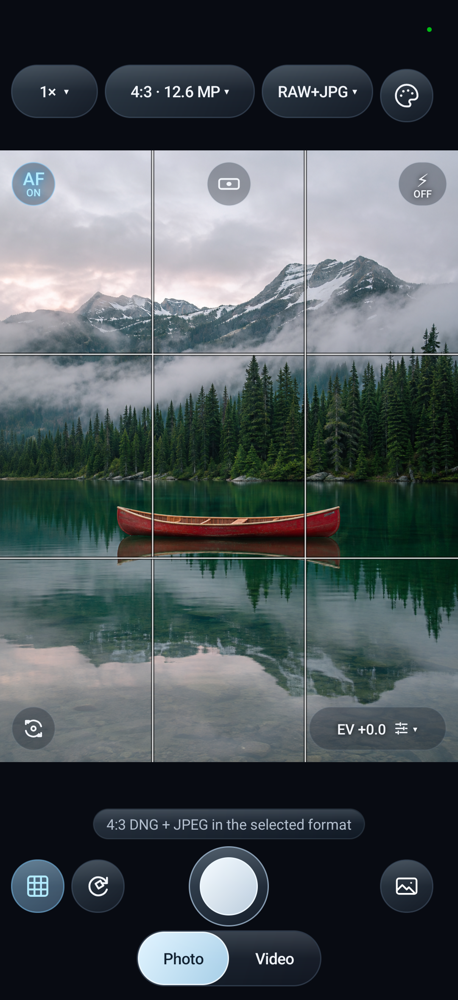
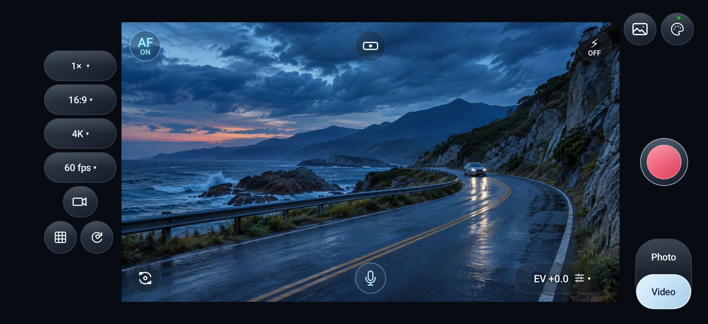

# CameraX9P

An Android camera app by **hambs**, built for the OPPO Find X9 Pro.

**Public beta 0.22** was tested on the Find X9 Pro (CPH2791) with ColorOS 17. Camera, lens and recording options depend on the capabilities available to Android on each device.

| Photo | Video |
| --- | --- |
|  |  |

The screenshots show the app interface with generated scenes in the viewfinder. [View the video profile menu](docs/images/video-profiles.png) · [Image credits](docs/images/README.md).

## Features

- JPEG, RAW DNG and RAW + JPEG capture where supported, with burst, self-timer and exposure bracketing.
- Xpan-style framing and a Polaroids frame with an optional caption.
- Video up to 4K, with Standard, Action, Horizon Lock, Slow Motion, Super Slow Motion and Time-lapse profiles. Available formats include 16:9, 4:3 and Modalità OG on supported configurations.
- Tap-to-focus, manual focus, grid, level, zoom ruler and individual resets for adjusted settings.
- Monochrome and optional SDR `.cube` LUT export for JPEG and MP4. Phone, wired and Bluetooth microphone options are available where Android exposes a compatible input.

## Install the beta

Open **Releases**, select **CameraX9P 0.22 Beta** and download `CameraX9P-0.22-beta.apk`. Android may ask you to allow APK installation for the app that opened the download. Grant camera access when you first open the viewfinder. If you record with a microphone, Android will ask for audio access.

The APK requires Android 12 or later. Testing covered installation from scratch on the Find X9 Pro (CPH2791) with ColorOS 17. Android requires matching signing certificates for in-place updates. If you previously installed a development build, back up its private app data before replacing it.

## Build from source

Install Android SDK Platform 36 and Build Tools 36.0.0. Set `ANDROID_HOME` to the SDK directory and `JAVA_HOME` to a JDK supported by Gradle 9.3.1. The project was built with Android Studio's JDK 25. Java source targets version 17.

```powershell
.\gradlew.bat :probe:assembleDebug :probe:lintDebug
.\scripts\test-core.ps1 -JdkHome $env:JAVA_HOME
```

On macOS or Linux use `sh ./gradlew :probe:assembleDebug :probe:lintDebug`. The debug APK is under `probe/build/outputs/apk/debug/`. The `:probe:assembleRelease` task builds the unsigned release variant.

## Project and license

- [System Card](SYSTEM_CARD.md)
- [Beta validation](docs/VALIDATION.md)
- [Contributing](CONTRIBUTING.md)
- [Security](SECURITY.md)
- [Project notice](NOTICE.md) and [third-party notices](THIRD_PARTY_NOTICES.md)

Original project materials are available under the [PolyForm Noncommercial License 1.0.0](LICENSE). Third-party components retain their own licenses.
